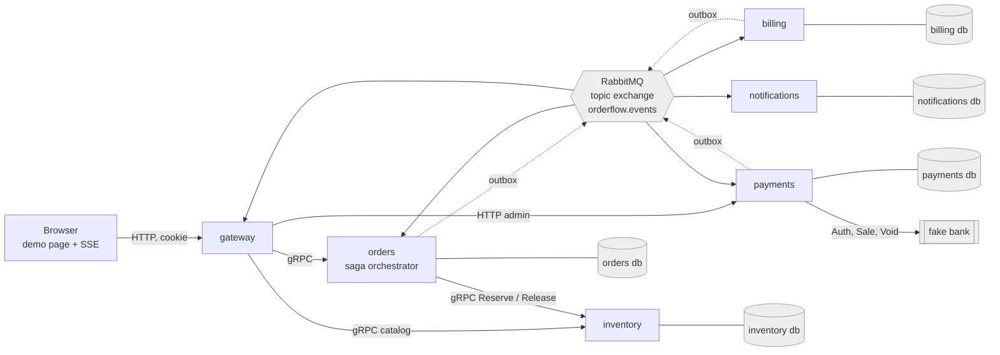
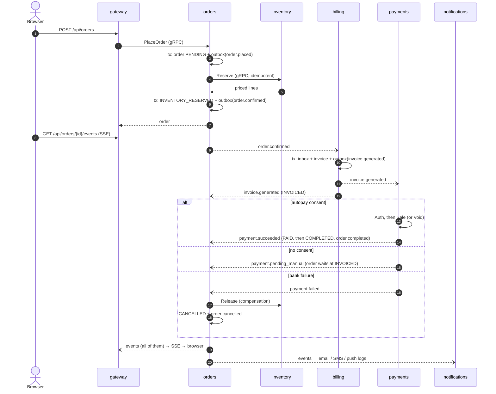
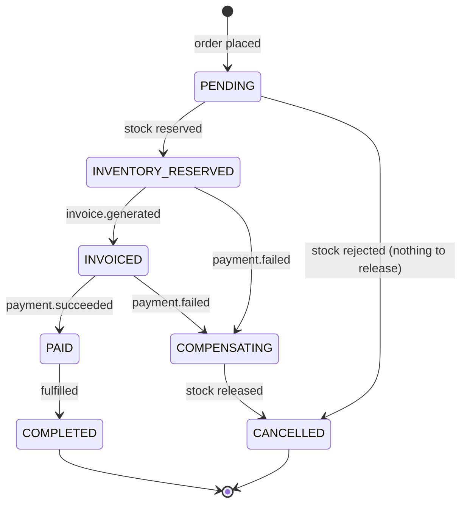

# orderflow

An event-driven e-commerce order flow in Go: place an order in the browser and
watch it move live through stock reservation, invoicing, automatic card payment
and notifications, or fail and **compensate** in front of you.

It is a Go redesign of an earlier .NET system by the same author (Angular +
SignalR + RabbitMQ/MassTransit) where the browser followed an order's progress
while backend services validated inventory, generated an invoice, auto-charged a
saved card when the customer had opted in, and notified them by email, SMS or
push. This version keeps the idea and rebuilds it with explicit patterns:
orchestrated saga, transactional outbox, idempotent consumers, retry with DLQ,
and end-to-end tracing.

> **What is simulated.** There is no identity provider (a demo login issues a
> signed cookie for three seeded users), no real bank (a fake gateway with
> Auth/Sale/Void semantics), and no real email/SMS/push (the channel adapters
> only write structured log lines). Everything else (the database
> transactions, the broker, the saga, retries, tracing) is real. See
> [Trade-offs](#trade-offs-and-known-gaps).

**New here?** Start with [docs/start-here.md](docs/start-here.md): what to install, what to click, what each tool is for.

## Architecture



| Service | Role | Talks to |
|---|---|---|
| `gateway` | HTTP API, static demo page, SSE timeline, simulated login | orders, inventory (gRPC); payments (HTTP); consumes all events |
| `orders` | Owns orders and the **orchestrated saga**; transactional outbox | inventory (gRPC); consumes invoice and payment events |
| `inventory` | Products, stock, idempotent `Reserve` / `Release` | Postgres only |
| `billing` | `order.confirmed` to invoice to `invoice.generated` | broker, Postgres |
| `payments` | Autopay decision, fake bank (Auth then Sale or Void), failure switch | broker, Postgres |
| `notifications` | Per-customer channels (email / SMS / push), logs only | broker, Postgres |

Infrastructure: one Postgres instance (a database per service), RabbitMQ with
the management UI, Jaeger all-in-one. Each service follows a hexagonal layout with one package per use case:
`internal/domain` (pure) ← use-case packages named by what they do
(`placing`, `charging`, `notifying`, ...) ← `internal/adapters/*` ←
`cmd/<name>/main.go`. See [docs/conventions.md](docs/conventions.md).

### Event flow



### Saga state machine



Invalid transitions (a late or duplicate event) are rejected by the domain,
logged and ignored; they never change state.

## Run it

Requirements: Docker with Compose v2. Go 1.26 only if you want to run tests
locally.

```sh
make up          # docker compose up --build -d --wait
```

The first start can take a few minutes (image build, database init). Then:

| What | URL |
|---|---|
| Demo page | http://localhost:8080 |
| Jaeger (traces) | http://localhost:16686 |
| RabbitMQ management | http://localhost:15672 (user `orderflow`, password `orderflow-demo-password`) |

Stop and remove everything including volumes: `make down`.

Configuration is via environment variables with demo defaults baked into
`docker-compose.yml`, so no `.env` is needed. Override with a local `.env`
(git-ignored): `POSTGRES_PASSWORD`, `RABBITMQ_PASSWORD`, `SESSION_SECRET`
(at least 16 bytes), `PAYMENTS_FAIL_STAGE` (empty, `auth` or `sale`),
`GATEWAY_PORT`, `RABBITMQ_UI_PORT`, `JAEGER_UI_PORT`. All defaults are
demo-only and must never be reused.

### Make targets

| Target | Does |
|---|---|
| `make up` / `make down` | start the stack / stop it and remove volumes |
| `make test` | `go vet` and unit tests with the race detector (no Docker needed) |
| `make test-integration` | integration tests with testcontainers (needs Docker) |
| `make lint` | `golangci-lint` (install with `make tools`) |
| `make proto` | `buf lint` and `buf generate` into `gen/` |
| `make smoke` | end-to-end script against the running stack |

## Demo walkthrough

**Happy path**

1. Open http://localhost:8080 and log in as **Alice** (autopay card).
2. Choose a product quantity and press **Place order**.
3. The timeline fills in live: *order placed → stock reserved, order confirmed →
   invoice generated → payment succeeded → order completed*, and the state chip
   turns `COMPLETED`. Stock in the product table drops.
4. Log in as **Carol** to see all three notification channels fire, or as
   **Bob**, whose card has *no autopay consent*: the order stops at `INVOICED`
   with *waiting for manual payment*.

**Failure and compensation**

1. As Alice, set the **Payment failure switch** to `sale` and press Apply.
2. Place an order. The authorization succeeds, the capture fails, the bank
   authorization is **voided**, `payment.failed` is published, `orders` releases
   the stock (compensation) and the order ends `CANCELLED` with the reason shown.
   The stock count goes back up.
3. `auth` makes the bank decline the authorization instead. Set it back to `off`.

Or run the same scenarios unattended: `make smoke`. Every control, five scenarios
(including retries and the DLQ) and the RabbitMQ setup are explained step by step in
[docs/demo-guide.md](docs/demo-guide.md); the live timeline in [docs/sse.md](docs/sse.md).

## Where to look

- **Guided tour of the code** (one order, end to end, file by file):
  [docs/walkthrough.md](docs/walkthrough.md).
- **Code conventions** (naming, layering, use-case packages, errors, logging):
  [docs/conventions.md](docs/conventions.md).
- **Jaeger** (http://localhost:16686): service `gateway`, operation
  `POST /api/orders`. One trace covers HTTP, gRPC, the outbox relay, the broker
  and all consumers, including the compensation call.
- **RabbitMQ UI** → Exchanges → `orderflow.events`; Queues → `*.q`, `*.retry.N`,
  `*.dlq`.
- **Logs**: every line is JSON with `service`, `order_id`, `trace_id`, `span_id`.

  ```sh
  docker compose logs --no-log-prefix \
    | jq -R -c --arg o "<order id>" 'fromjson? | select(.order_id == $o)' \
    | jq -s -r 'sort_by(.time)[] | "\(.time[11:23]) \(.service) \(.level) \(.msg)"'
  ```

  More recipes and the reasoning: [docs/observability.md](docs/observability.md).
- **Why things are the way they are**: [DECISIONS.md](DECISIONS.md).

## Testing

- **Unit tests** (`go test ./...`, no Docker): table-driven, behaviour-first.
  Saga transitions including compensation and invalid transitions; the
  orchestration use cases against in-memory ports with real commit/rollback
  semantics; inventory reservation rules; the autopay decision; invoice
  tax maths; notification planning; session tokens; the SSE hub.
- **Integration tests** (`-tags=integration`, testcontainers: Postgres 17 and
  RabbitMQ 4): the outbox relay publishes each row exactly once (with two
  concurrent relays) and resumes after a broker failure; the inbox drops
  duplicates and rolls back with the handler; failing messages are retried and
  then dead-lettered; permanent failures skip retries; the saga persists
  correctly in Postgres; concurrent reservations never oversell.
- **Smoke test** (`scripts/smoke.sh`): against the compose stack: login, order
  completes; no-consent order waits; failure switch cancels the order and
  releases stock; oversized order is cancelled at reservation.
- **CI** (`.github/workflows/ci.yml`): lint, unit tests, integration tests,
  protobuf drift check, compose build and smoke test. Actions are pinned by
  commit SHA, token permissions are read-only, credentials are not persisted.

## Trade-offs and known gaps

- **Simulated**: authentication (signed cookie for seeded users, no password),
  the bank, and the notification channels (logs only).
- **Manual payment is a dead end**: `payment.pending_manual` leaves the order
  `INVOICED`; there is no pay-now flow or expiry ([ADR 24](DECISIONS.md)).
- **At-least-once delivery** end to end, with exactly-once *effects* inside each
  database thanks to the inbox. External effects (bank, notifications) rely on
  idempotency keys or are documented as at-least-once.
- **Compensation holds a DB transaction across a gRPC call**. Fine at this
  scale, wrong at high throughput ([ADR 20](DECISIONS.md)).
- **Polling outbox relay** (500 ms) instead of CDC or `LISTEN/NOTIFY`.
- **A failed void is only logged**: a held authorization after a declined sale is not cleaned up automatically ([ADR 29](DECISIONS.md)).
- **Gateway timeline is in memory** (last 500 orders), single instance.
- **Hand-rolled migrations** (forward-only), one shared Postgres user,
  always-on trace sampling, logs only on stdout. Production notes are in
  [docs/observability.md](docs/observability.md).
- **Not covered by automated tests**: the browser page itself (no UI tests),
  a broker outage across the whole compose stack (the integration test covers the orders service only), and load behaviour.

## Keywords

Go (Golang), microservices, event-driven architecture, distributed systems, gRPC, Protocol Buffers (buf), RabbitMQ (topic exchange, retry queues, dead-letter queue), saga pattern (orchestration, compensation), transactional outbox, idempotent consumers (inbox), at-least-once delivery, hexagonal architecture (ports and adapters), domain-driven design, PostgreSQL (pgx), OpenTelemetry, distributed tracing, Jaeger, structured logging (slog), Server-Sent Events (SSE), Docker, Docker Compose, testcontainers, integration testing, golangci-lint, GitHub Actions CI, architecture decision records (ADRs).

## Layout

```
proto/            protobuf sources (buf)         gen/        generated Go (committed)
services/<name>/  cmd/, internal/{domain, <use-case packages>, adapters}
internal/platform/ config, telemetry, outbox, inbox, rabbitmq, database, health, events
test/             testcontainers helpers + integration tests
scripts/smoke.sh  end-to-end smoke test         docker/     Postgres init script
docs/             conventions, guides (demo, SSE, logs)      Makefile, docker-compose.yml, Dockerfile
```
